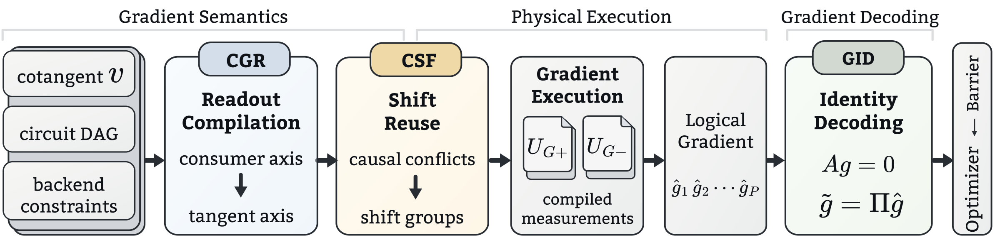
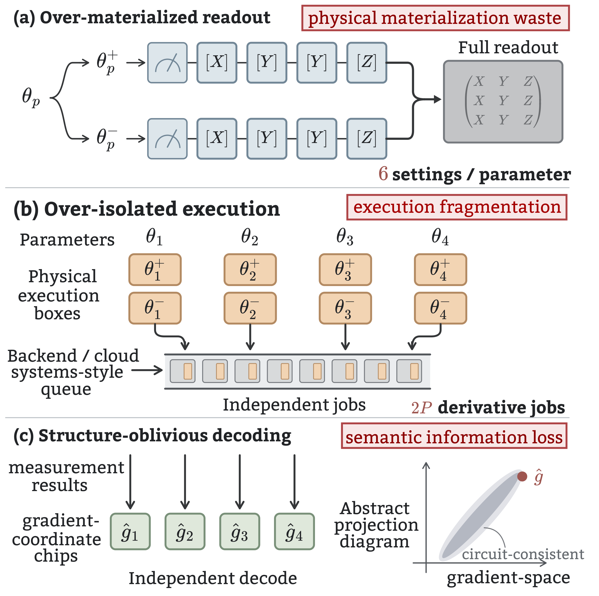

<h1 align="center">GraQ</h1>
<h3 align="center">Compiling Quantum Gradients into Efficient Execution Plans</h3>
<p align="center"><strong>A compiler and runtime for quantum backpropagation</strong></p>
<p align="center">
  <a href="#overview">Overview</a> &nbsp; / &nbsp;
  <a href="#motivation">Motivation</a> &nbsp; / &nbsp;
  <a href="#results">Results</a> &nbsp; / &nbsp;
  <a href="#quick-start">Quick Start</a> &nbsp; / &nbsp;
  <a href="#code-guide">Code</a>
</p>

<br>

GraQ compiles an entire quantum backward request into an execution plan. It uses the classical consumer's cotangent, circuit dependencies, and exact gradient identities to **reduce quantum work and improve finite-shot gradient estimates**.

<p align="center">
  
</p>

<table>
  <tr>
    <td align="center" width="33%">
      <h2>83.1% fewer</h2>
      <strong>Derivative circuits</strong><br>
      <sub>160 independent circuit instances</sub>
    </td>
    <td align="center" width="33%">
      <h2>80.6% lower</h2>
      <strong>Gradient MSE</strong><br>
      <sub>Matched total shots · same study</sub>
    </td>
    <td align="center" width="33%">
      <h2>144 → 28</h2>
      <strong>Hardware gradient jobs</strong><br>
      <sub>Physical quantum processor</sub>
    </td>
  </tr>
</table>

## Overview

GraQ connects the gradient requested by the loss to the measurements that produce it. Its three transformations operate on readout, execution, and decoding:

- **CGR — Consumer- and Generator-Aware Readout.** Contracts local observables into the consumer's measurement direction and removes certified derivative-null components.
- **CSF — Causal Shift Fusion.** Co-executes compatible parameter shifts, preserving a separate reconstruction path for every derivative.
- **GID — Gradient Identity Decoding.** Projects the sampled estimate onto a certified legal gradient space using the same measurement outcomes.

> **Exact rewrites. Certified decoding.** CGR and CSF preserve the exact vector–Jacobian product. With a valid certificate, GID cannot increase total squared estimation error and requires no additional quantum executions.

## Motivation

<table>
  <tr>
    <td width="54%" valign="middle">
      
    </td>
    <td width="46%" valign="top">
      <h3>One backward request can generate hundreds of executions.</h3>
      <p>With <code>P</code> trainable rotations and local XYZ readouts, conventional parameter shift emits <strong>6P derivative configurations</strong>.</p>
      <p><strong>Readout redundancy</strong><br>
      The loss consumes a weighted direction, while execution resolves separate output components.</p>
      <p><strong>Execution redundancy</strong><br>
      Compatible perturbations run as independent jobs despite disjoint consumed outputs.</p>
      <p><strong>Estimation redundancy</strong><br>
      Independently estimated coordinates can violate exact gradient identities.</p>
      <p>GraQ carries these relationships through a single execution plan.</p>
    </td>
  </tr>
</table>

## Results

The paper evaluates gradient execution, end-to-end training, physical-device execution, and compilation scaling.

| Evaluation              | Scope                            | Key result                                                                                  |
| :---------------------- | :------------------------------- | :------------------------------------------------------------------------------------------ |
| **Gradient execution**  | 160 independent instances        | **182.0 → 30.7** mean derivative configurations; **80.6% lower MSE** at matched total shots |
| **End-to-end training** | SST-2 · AG News · Fashion-MNIST  | **71.2% fewer circuits** and **69.9% fewer shots**                                          |
| **Physical hardware**   | A study completing 660 jobs      | **144 → 28** gradient jobs; **59.4% lower mean paired MSE** at a matched shot budget        |
| **Compilation scaling** | Up to 32 qubits · 576 parameters | **238 ms** largest observed planning time                                                   |

<sub>Resource and MSE reductions are relative to conventional parameter-shift execution. Training counts include forward evaluation and input-adapter gradients. Compilation scaling measures structural planning separately from state-vector execution.</sub>

## Quick Start

The core simulator runs locally with **Python 3.10+ and NumPy**. From the repository root:

```bash
python -m venv .venv
source .venv/bin/activate
python -m pip install numpy
```

Compile a small circuit and compare parameter shift with the full GraQ pipeline:

```python
import numpy as np

from GraQ import Workload, compile_plan, estimate, make_case

spec = Workload(qubits=4, depth=1, topology="block", block_size=2)
x, theta, cotangent = make_case(spec, seed=42)
plan = compile_plan(spec, x, theta, cotangent)

for method in ("ps_xyz", "graq"):
    gradient, stats = estimate(
        plan, method=method, shots=256, rng=np.random.default_rng(42)
    )
    print(
        f"{method}: circuits={stats['circuits']}, "
        f"shots={stats['shots']}"
    )
```

<details>
<summary>Expected output and shot accounting</summary>


```text
ps_xyz: circuits=96, shots=24576
graq: circuits=12, shots=3072
```

This example uses **256 shots per configuration** and demonstrates resource reduction on a small simulated circuit. The paper's matched-total-shot MSE comparisons use a separate evaluation protocol.

Use `method="graq"` for the complete pipeline. The `consumer_axis`, `cgr`, and `cgr_csf` modes expose individual stages for ablation studies.

</details>

## Code Guide

| Component    | Source                                      | Responsibility                                        |
| :----------- | :------------------------------------------ | :---------------------------------------------------- |
| **CGR**      | [`cgr.py`](GraQ/cgr.py)                     | Consumer- and generator-aware readout                 |
| **CSF**      | [`csf.py`](GraQ/csf.py)                     | Causal conflict analysis and shift fusion             |
| **GID**      | [`gid.py`](GraQ/gid.py)                     | Gradient identity certificates and decoding           |
| **Runtime**  | [`engine.py`](GraQ/engine.py)               | Plan compilation, estimation, and resource accounting |
| **Training** | [`text_training.py`](GraQ/text_training.py) | Shared hybrid-training loop and baselines             |

<details>
<summary>Supporting modules</summary>

- [`circuit.py`](GraQ/circuit.py) — state-vector simulation and exact gradient references.
- [`measurement.py`](GraQ/measurement.py) — joint-bitstring sampling with shot covariance.
- [`workloads.py`](GraQ/workloads.py) — circuit families and reproducible input generation.
- [`io.py`](GraQ/io.py) — JSON result export.
- [`__init__.py`](GraQ/__init__.py) — public Python interface.

</details>
